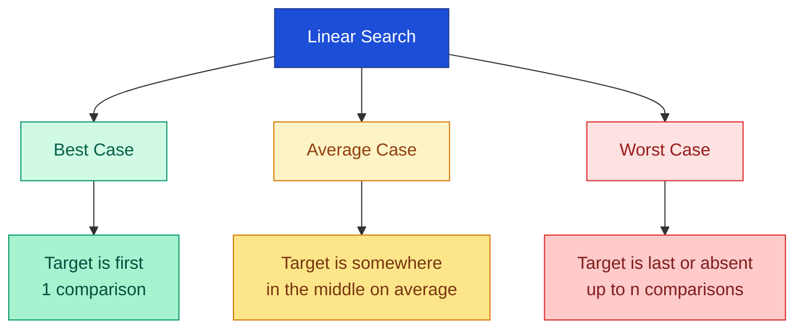
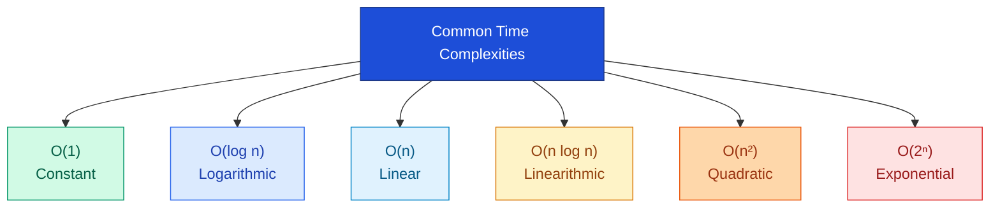
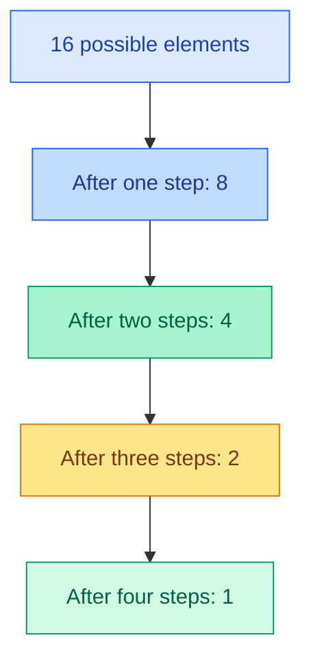
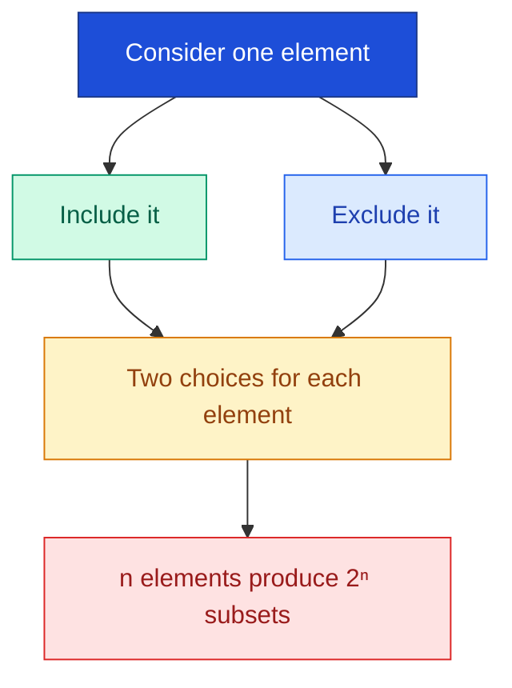
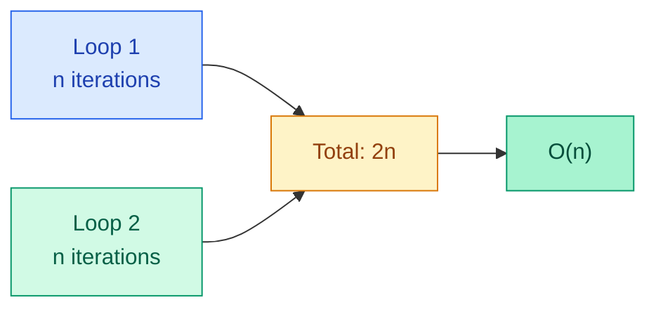
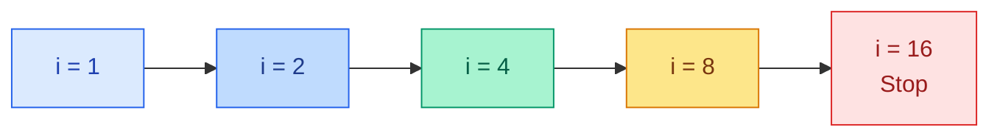
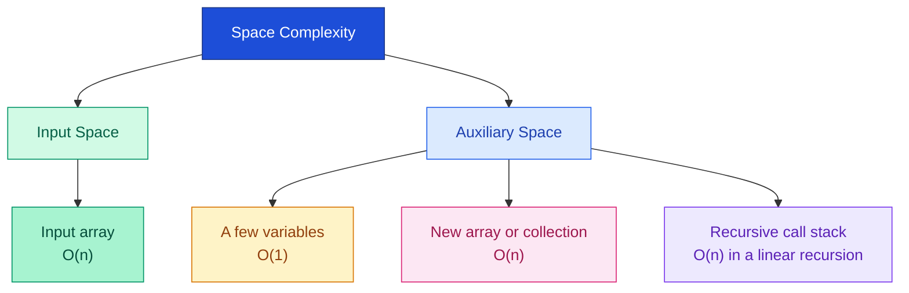
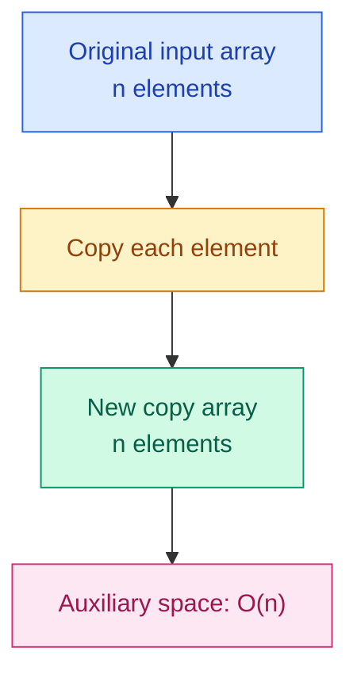

# Lec 11: Time & Space Complexity

> **Subject:** Data Structures & Algorithms (DSA)  
> **Focus:** Understand how algorithm time and memory requirements grow as input size increases.  
> **Learning style:** Simple explanations, Java examples, coloured diagrams, and practice questions.

---

## Learning Outcomes

After this lecture, you should be able to:

- Explain why algorithms are analysed.
- Distinguish best, average, and worst cases.
- Understand Big-O notation and common complexity classes.
- Analyse single, consecutive, nested, triangular, and logarithmic loops.
- Distinguish input space from auxiliary space.
- Estimate the time and auxiliary space complexity of simple Java code.

---

# 1. Why Analyse Algorithms?

An **algorithm** is a step-by-step procedure for solving a problem. For example, checking names one by one to find a student is a searching algorithm.

When two programs solve the same problem, they may do different amounts of work. Algorithm analysis helps us understand how that work changes as the input grows.

## Example: One element vs every element

```java
// Program A: access one element
System.out.println(arr[0]);

// Program B: visit every element
for (int i = 0; i < arr.length; i++) {
    System.out.println(arr[i]);
}
```

- Program A performs a fixed amount of work for this operation.
- Program B visits every element, so its work grows with the array size.

We analyse algorithms to understand **efficiency**, **scalability**, and **resource usage**. We usually study growth rather than relying only on seconds measured on one computer, because hardware, language, and environment can affect timing.

## 1.1 Best, Average, and Worst Case

Consider **linear search**, which checks an array from left to right until it finds the target.

```java
int[] arr = {10, 20, 30, 40, 50};
int target = 30;

for (int i = 0; i < arr.length; i++) {
    if (arr[i] == target) {
        System.out.println("Found");
        break;
    }
}
```

### Coloured diagram: How many elements are checked?



| Case | Meaning | Linear search example |
|---|---|---|
| **Best case** | Minimum work for an input of size `n` | Target is first: 1 comparison |
| **Average case** | Expected work over a specified distribution of inputs | If the target is equally likely to be at any position and is present: about `(n + 1) / 2` comparisons |
| **Worst case** | Maximum work for an input of size `n` | Target is last or absent: up to `n` comparisons |

**Important:** Average-case analysis depends on assumptions about the input. If the target can be absent, the average changes with how likely absence is.

### Remember

- Best case = minimum work.
- Average case = expected work under stated assumptions.
- Worst case = maximum work.

---

# 2. Big-O Notation and Common Complexities

## 2.1 What is Big-O?

**Big-O notation** describes an asymptotic upper bound on how an algorithm's resource use grows as input size increases. In introductory DSA, it is commonly used to describe time or space complexity.

In simple terms: **Big-O tells us how the amount of work grows when the input size grows.**

For example:

```java
// O(1): one indexed access
System.out.println(arr[0]);

// O(n): visit every element
for (int i = 0; i < n; i++) {
    System.out.println(arr[i]);
}

// O(n^2): visit every pair of indices
for (int i = 0; i < n; i++) {
    for (int j = 0; j < n; j++) {
        System.out.println(i + " " + j);
    }
}
```

## 2.2 Common Complexity Classes



For these common growth rates, the usual order from slower growth to faster growth is:

\[
O(1) < O(\log n) < O(n) < O(n\log n) < O(n^2) < O(2^n)
\]

This compares asymptotic growth, not guaranteed runtime for every small input.

## 2.3 O(1) — Constant Time

```java
System.out.println(arr[0]);
```

An indexed array access takes constant time under the usual RAM-model assumption. The number of operations for this statement does not grow with the array length.

| Array size | Indexed access |
|---:|---:|
| 5 | Constant number of operations |
| 1,000 | Constant number of operations |
| 1,000,000 | Constant number of operations |

**Analogy:** Going directly to a known page number in a book.

> **Note:** `O(1)` does not mean exactly one CPU instruction or one second. It means constant growth.

## 2.4 O(log n) — Logarithmic Time

**Binary Search** works on a sorted array. Each comparison discards about half of the remaining search range.



Since \(2^4 = 16\), it takes about \(\log_2 16 = 4\) halvings to reduce 16 elements to one.

**Example:** Searching a sorted list by repeatedly checking its middle.

**Complexity:** `O(log n)`.

## 2.5 O(n) — Linear Time

```java
for (int i = 0; i < n; i++) {
    System.out.println(i);
}
```

The loop runs `n` times.

- If `n = 10`, it runs 10 times.
- If `n = 100`, it runs 100 times.
- If `n = 1,000`, it runs 1,000 times.

**Analogy:** Checking students' names one by one on an attendance list.

**Complexity:** `O(n)`.

## 2.6 O(n log n) — Linearithmic Time

Efficient comparison-based sorting algorithms such as **Merge Sort** have `O(n log n)` time complexity.

At a high level, Merge Sort divides the array into smaller parts across about `log n` levels and does about `n` total work per level.

\[
n \times \log n = O(n\log n)
\]

You will study the full sorting algorithm separately.

## 2.7 O(n²) — Quadratic Time

```java
for (int i = 0; i < n; i++) {
    for (int j = 0; j < n; j++) {
        System.out.println(i + " " + j);
    }
}
```

For every one of the `n` outer iterations, the inner loop runs `n` times.

\[
n \times n = n^2
\]

| `n` | Inner-loop body executions |
|---:|---:|
| 10 | 100 |
| 100 | 10,000 |
| 1,000 | 1,000,000 |

**Example use:** Comparing each element with every other element in a straightforward nested-loop solution.

**Complexity:** `O(n²)`.

## 2.8 O(2ⁿ) — Exponential Time

For every element, imagine making two choices: **include it** or **exclude it**. A set with `n` elements has `2ⁿ` possible subsets.

| `n` | Number of subsets, `2ⁿ` |
|---:|---:|
| 1 | 2 |
| 2 | 4 |
| 3 | 8 |
| 4 | 16 |
| 10 | 1,024 |
| 20 | 1,048,576 |



This growth becomes very large even for moderate values of `n`, so exhaustive brute-force algorithms can become impractical.

## 2.9 Quick Comparison

| Complexity | Common example | Growth |
|---|---|---|
| `O(1)` | Array index access | Constant |
| `O(log n)` | Binary Search | Logarithmic |
| `O(n)` | One full loop | Linear |
| `O(n log n)` | Merge Sort | Linearithmic |
| `O(n²)` | Two full nested loops | Quadratic |
| `O(2ⁿ)` | Enumerating all subsets | Exponential |

## 2.10 Simplifying Big-O Expressions

When simplifying common expressions, ignore constant factors and lower-order terms.

- `O(2n)` becomes `O(n)`.
- `O(n + 10)` becomes `O(n)`.
- `O(n² + n)` becomes `O(n²)`.
- `O(2n + n²)` becomes `O(n²)`.

**Why?** As `n` becomes large, the highest-growth term dominates.

---

# 3. Complexity Analysis of Loops and Nested Loops

The goal is to inspect code and work out how many times its important statements execute.

## A Repeatable Method

1. Identify the loop condition and update.
2. Try a small value, such as `n = 4`.
3. Count the iterations.
4. For nested loops, work out the inner-loop count for each outer iteration.
5. Express the total as a sum or product.
6. Simplify to Big-O.

## Pattern 1: One Loop

```java
for (int i = 0; i < n; i++) {
    System.out.println(i);
}
```

The loop runs `n` times.

**Time complexity:** `O(n)`.

## Pattern 2: Consecutive Loops

```java
for (int i = 0; i < n; i++) {
    System.out.println(i);
}

for (int j = 0; j < n; j++) {
    System.out.println(j);
}
```

The first loop runs `n` times and the second also runs `n` times.

\[
T(n) = n + n = 2n
\]

Ignoring the constant factor gives **`O(n)`**.



**Rule:** Add the work of consecutive loops.

## Pattern 3: Nested Loops

```java
for (int i = 0; i < n; i++) {
    for (int j = 0; j < n; j++) {
        System.out.println(i + " " + j);
    }
}
```

For `n = 3`:

| Outer loop `i` | Inner iterations |
|---:|---:|
| 0 | 3 |
| 1 | 3 |
| 2 | 3 |
| **Total** | **9** |

\[
T(n) = n \times n = n^2
\]

**Time complexity:** `O(n²)`.

**Rule:** When both loops run `n` times, multiply the iteration counts.

## Pattern 4: Different Loop Bounds

```java
for (int i = 0; i < n; i++) {
    for (int j = 0; j < m; j++) {
        System.out.println(i + " " + j);
    }
}
```

The outer loop runs `n` times and the inner loop runs `m` times per outer iteration.

\[
T(n,m) = n \times m
\]

**Time complexity:** `O(nm)`, not automatically `O(n²)`.

## Pattern 5: Inner Loop Depends on Outer Loop

```java
for (int i = 0; i < n; i++) {
    for (int j = 0; j <= i; j++) {
        System.out.println(i + " " + j);
    }
}
```

For `n = 4`:

| `i` | Inner-loop iterations |
|---:|---:|
| 0 | 1 |
| 1 | 2 |
| 2 | 3 |
| 3 | 4 |
| **Total** | **10** |

The total is:

\[
1 + 2 + 3 + \cdots + n = \frac{n(n+1)}{2}
\]

The highest-growth term is quadratic, so the time complexity is **`O(n²)`**.

## Pattern 6: A Loop That Doubles

```java
for (int i = 1; i < n; i = i * 2) {
    System.out.println(i);
}
```

For `n = 16`, `i` takes the values `1, 2, 4, 8`. The next value is `16`, where the condition fails.



The variable doubles each iteration. After `k` iterations, it is roughly `2ᵏ`. The loop stops when the value reaches `n`.

\[
2^k \approx n \quad\Rightarrow\quad k \approx \log_2 n
\]

**Time complexity:** `O(log n)`.

### Loop Patterns at a Glance

| Code pattern | Time complexity |
|---|---|
| One loop from `0` to `n - 1` | `O(n)` |
| Two consecutive loops of size `n` | `O(n)` |
| Two nested loops, each of size `n` | `O(n²)` |
| Nested loops with bounds `n` and `m` | `O(nm)` |
| Inner loop runs `1, 2, ..., n` times | `O(n²)` |
| Loop variable doubles each time | `O(log n)` |

> **Common mistake:** Two consecutive loops are not the same as two nested loops. Add consecutive loop work; multiply nested loop work when the inner count repeats for each outer iteration.

---

# 4. Space Complexity: Input Space vs Auxiliary Space

**Space complexity** describes how an algorithm's memory use grows with input size.

- **Input space:** Memory used to store the input supplied to the algorithm.
- **Auxiliary space:** Extra memory used by the algorithm, excluding the input storage itself.



## Example 1: Sum an Array

```java
int sumArray(int[] arr) {
    int sum = 0;

    for (int i = 0; i < arr.length; i++) {
        sum += arr[i];
    }

    return sum;
}
```

- `arr` is the input array.
- `sum` and `i` use a fixed amount of extra memory.
- No second array is created.

| Measurement | Complexity |
|---|---|
| Input space | `O(n)` |
| Auxiliary space | `O(1)` |
| Total space including input | `O(n)` |

## Example 2: Copy an Array

```java
int[] copyArray(int[] arr) {
    int[] copy = new int[arr.length];

    for (int i = 0; i < arr.length; i++) {
        copy[i] = arr[i];
    }

    return copy;
}
```

The method creates a second array with `n` elements.



- Input space: `O(n)`.
- Auxiliary space: `O(n)`, for the new array.
- Total space including both arrays: `O(n)` because constant factors are ignored.

## Example 3: Reverse an Array In Place

```java
void reverse(int[] arr) {
    int left = 0;
    int right = arr.length - 1;

    while (left < right) {
        int temp = arr[left];
        arr[left] = arr[right];
        arr[right] = temp;

        left++;
        right--;
    }
}
```

The method uses only `left`, `right`, and `temp`. It does not create another array.

**Auxiliary space:** `O(1)`.

The input array is modified in place.

## Example 4: Recursion Uses Stack Space

```java
int factorial(int n) {
    if (n <= 1) {
        return 1;
    }

    return n * factorial(n - 1);
}
```

Each recursive call needs a stack frame. For `n`, there are about `n` active calls at maximum depth.

- Time complexity: `O(n)`.
- Auxiliary space complexity: `O(n)` due to the call stack.

**Remember:** A method can use extra memory even if it does not create an array or collection.

## Space Complexity Summary

| Example | Auxiliary space |
|---|---|
| Sum an array using a loop | `O(1)` |
| Copy an array | `O(n)` |
| Reverse an array in place | `O(1)` |
| Recursive factorial | `O(n)` stack space |

---

# 5. Practice Questions

Try to solve these before checking the answers. For code-analysis questions, explain **why** the complexity is correct.

## Question 1: Best, Average, and Worst Case

A linear search checks an array of 100 elements. The target is at the last position. How many elements will be compared?

- A. 1
- B. 50
- C. 100
- D. 101

## Question 2: Big-O

What is the time complexity of this code?

```java
for (int i = 0; i < n; i++) {
    System.out.println(i);
}
```

- A. `O(1)`
- B. `O(log n)`
- C. `O(n)`
- D. `O(n²)`

## Question 3: Consecutive Loops

What is the time complexity?

```java
for (int i = 0; i < n; i++) {
    System.out.println(i);
}

for (int j = 0; j < n; j++) {
    System.out.println(j);
}
```

- A. `O(1)`
- B. `O(n)`
- C. `O(n²)`
- D. `O(2ⁿ)`

## Question 4: Nested Loops

What is the time complexity?

```java
for (int i = 0; i < n; i++) {
    for (int j = 0; j < n; j++) {
        System.out.println(i + " " + j);
    }
}
```

- A. `O(n)`
- B. `O(n log n)`
- C. `O(n²)`
- D. `O(2ⁿ)`

## Question 5: Doubling Loop

What is the time complexity?

```java
for (int i = 1; i < n; i *= 2) {
    System.out.println(i);
}
```

- A. `O(1)`
- B. `O(log n)`
- C. `O(n)`
- D. `O(n²)`

## Question 6: Auxiliary Space

You receive an array of `n` integers and use only two variables to find its maximum element. What is the auxiliary space complexity?

- A. `O(1)`
- B. `O(n)`
- C. `O(n²)`

## Question 7: Array Copy

A method receives an array of size `n` and creates another array of the same size. What is the auxiliary space complexity?

- A. `O(1)`
- B. `O(log n)`
- C. `O(n)`
- D. `O(n²)`

## Question 8: Analyse This Code

Write the time complexity and explain your answer.

```java
for (int i = 0; i < n; i++) {
    for (int j = 0; j <= i; j++) {
        System.out.println(i + " " + j);
    }
}
```

---

# 6. Answer Key

<details>
<summary>Click to reveal answers</summary>

1. **C — 100 comparisons.** The target is at the last position, so every preceding element must be checked first.
2. **C — `O(n)`.** The loop runs `n` times.
3. **B — `O(n)`.** The total work is `n + n = 2n`, which simplifies to `O(n)`.
4. **C — `O(n²)`.** The inner loop runs `n` times for each of `n` outer iterations.
5. **B — `O(log n)`.** The loop variable doubles every iteration.
6. **A — `O(1)`.** A fixed number of extra variables is used.
7. **C — `O(n)`.** The new array stores `n` elements.
8. **`O(n²)`.** The inner loop runs `1 + 2 + ... + n = n(n+1)/2` times, whose dominant term is quadratic.

</details>

---

# 7. Assignment / Practical

Analyse the following code snippets. For each one, write:

1. The number of iterations or a suitable expression for it.
2. The time complexity in Big-O notation.
3. The auxiliary space complexity.
4. A short justification.

### Snippet A

```java
int total = 0;

for (int i = 0; i < n; i++) {
    total += i;
}
```

### Snippet B

```java
for (int i = 0; i < n; i++) {
    for (int j = 0; j < n; j++) {
        System.out.println(i + j);
    }
}
```

### Snippet C

```java
for (int i = 1; i < n; i *= 2) {
    System.out.println(i);
}
```

**Submission format:**

| Snippet | Iteration count / expression | Time complexity | Auxiliary space | Justification |
|---|---|---|---|---|
| A |  |  |  |  |
| B |  |  |  |  |
| C |  |  |  |  |

---

## Final Revision

- **Time complexity** describes how running work grows with input size.
- **Space complexity** describes how memory use grows with input size.
- **Best, average, and worst cases** describe different input situations.
- **Big-O** expresses an asymptotic upper bound on growth.
- **Consecutive loops:** add their work.
- **Nested loops:** multiply iteration counts when the inner work repeats for every outer iteration.
- **Doubling or halving loops:** often have logarithmic complexity.
- **Auxiliary space** is extra memory beyond the input storage.
- Always justify your answer by counting work or identifying memory that grows with `n`.
